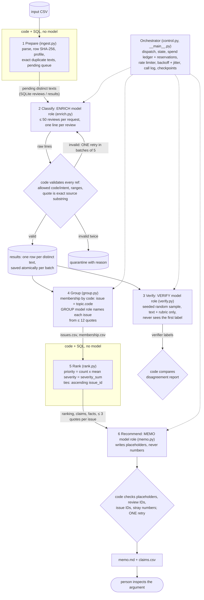

# Spotify Insight Pipeline (Final Assignment)

Turns the 97.4 MB course extract of Spotify Google Play reviews (660,622 rows, May 2022 to Nov 2023) into a
ranked list of product issues and a decision memo whose every number traces back to saved calculations and
source review IDs.

**Final full-corpus run:** [`runs/spotify_reviews_18months__gpt-6-luna-none-4aab826f/`](runs/spotify_reviews_18months__gpt-6-luna-none-4aab826f/) (2026-10-09; manifest: [`run_manifest.json`](runs/spotify_reviews_18months__gpt-6-luna-none-4aab826f/run_manifest.json)),
exported to [`grading/`](grading/). Decision memo: [`memo.md`](memo.md). Label guide with real examples: [`LABELS.md`](LABELS.md).
Cost calculator and replay instructions: [`cost/README.md`](cost/README.md).

## Results summary

All figures below are measured from saved runs; estimates are labelled as estimates.

| Item | Value | Evidence |
|---|---|---|
| Source rows accounted for | **660,622 of 660,622** (0 missing, 0 duplicate IDs) | `grading/records.jsonl.gz`, [`evals/self_check_summary.json`](evals/self_check_summary.json) |
| Completed classifications | **660,532 of 660,609** nonempty reviews (99.988%) | same |
| Quarantined | **13** empty texts (`empty_review_text`) + **77** nonempty (76 invalid model output after the single retry, 1 provider rejection) | [`quarantine.jsonl`](runs/spotify_reviews_18months__gpt-6-luna-none-4aab826f/quarantine.jsonl) |
| Exact-text cache reuse | 484,189 distinct texts sent once; **176,419** rows reuse a result with `cache_source_id` | checker: `valid_cache_reuses` |
| Golden set (my 50 hand labels) | topic **74%**, intent **90%**, severity exact **82%** (MAE 0.24), sentiment MAE 0.12; 9 ambiguous cases | [`evals/golden_report.md`](evals/golden_report.md) |
| Independent verifier (2,000 seeded reviews) | topic **87.1%**, intent **94.8%**, severity exact **91.5%**; 421 records disagree on at least one field | [`verify_report.json`](runs/spotify_reviews_18months__gpt-6-luna-none-4aab826f/verify_report.json), `verify_disagreements.csv` |
| Injection / planted-error tests | 10 of 10 synthetic cases pass; 30 of 30 planted wrong labels detected, 0 false alarms | [`evals/injection/`](evals/injection/), [`evals/planted_error_results.json`](evals/planted_error_results.json) |
| 100-review pilot | cold **$0.0044**, 84.4 s; warm **$0.00**, 0.4 s, **0** new model calls | [`cost/report.md`](cost/report.md) |
| Full-run API cost | **$5.91** for every call behind the full export (enrich $5.86, verify $0.04, group and memo under $0.01) | [`run_summary.json`](runs/spotify_reviews_18months__gpt-6-luna-none-4aab826f/run_summary.json), `grading/calls.jsonl.gz` |
| Full-run time | 67 min wall-clock for the resumed run: enrichment 51 min at 24 workers (about 154 texts/s), verification 12 min, grouping, memo, ranking and export 4.5 min | `stage_log.jsonl` |
| Instructor checker | coverage point candidate **0.9999**; the only flag is `unfinished_classification: 77` (the disclosed quarantines) | `evals/self_check_summary.json` |

Top of the baseline ranking (complaint and cancellation reviews only; score = count × mean severity = severity sum):

| Rank | Issue | Name (from the grouping step) | Complaints | Mean severity | Priority score | Cancellation-intent reviews |
|---|---|---|---|---|---|---|
| 1 | `billing.paywall` | Free-Tier Features Require Premium | 55,963 | 2.911209 | 162,920 | 10,314 |
| 2 | `other.general` | General dissatisfaction with Spotify | 78,126 | 1.995469 | 155,898 | 5,548 |
| 3 | `usability.ads` | Frequent and intrusive ads | 38,542 | 2.139121 | 82,446 | 2,421 |
| 4 | `usability.controls` | Unreliable Playback and Queue Controls | 20,265 | 2.960474 | 59,994 | 1,746 |
| 5 | `usability.ui` | Interface Changes and Hidden Controls | 20,411 | 2.271863 | 46,371 | 2,612 |
| 6 | `playback.stops` | Playback Stops or Skips Unexpectedly | 13,643 | 3.241589 | 44,225 | 1,353 |
| 7 | `playback.crash` | App Crashes or Fails to Open | 9,275 | 3.600970 | 33,399 | 581 |
| 8 | `access.login` | Login and Account Access Problems | 8,187 | 3.904605 | 31,967 | 396 |

All 22 issues: [`grading/ranking.csv`](grading/ranking.csv); topic and monthly rollups:
[`aggregates_by_topic.csv`](runs/spotify_reviews_18months__gpt-6-luna-none-4aab826f/aggregates_by_topic.csv), `aggregates_by_month.csv`.

Two things to read with the ranking:

- `other.general` (rank 2) is generic "bad app" criticism with no stated defect, so it is not an actionable product
  area. 34,427 of its 78,126 reviews arrived in July 2023, the month of a boycott wave; many say only "hate this
  application". The memo treats it as non-actionable.
- `billing.paywall` complaints were 3.0% of completed reviews in Aug–Oct 2022 (2,530 of 85,227) and 20.9% in
  Aug–Oct 2023 (33,716 of 161,157), peaking at 26,050 in October 2023. These are shares of self-selected reviews
  in comparable calendar periods, not a measured effect of any change.

## Check the evidence without an API key

```bash
python -m unittest discover -s tests -v            # 16 offline system tests (stand-in model + injected faults)
python cost/calculator.py                          # replay the saved 100-review pilot and projections
python cost/calculator.py --rate-multiplier 2      # API cost doubles; measured time and local cost do not
python cost/calculator.py --set projected.distinct_nonempty_texts=600000   # projection changes; pilot does not
python -m pipeline rerank --grading grading        # recompute the ranking from saved files: prints IDENTICAL
python evals/golden_eval.py --predictions runs/spotify_reviews_18months__gpt-6-luna-none-4aab826f/enriched.jsonl.gz
python evals/planted_error_test.py --run-dir runs/spotify_reviews_18months__gpt-6-luna-none-4aab826f
python check_submission.py reference --full data/spotify_reviews_18months.csv --analysis data/spotify_reviews_18months.csv --out local-reference.json
python check_submission.py check --reference local-reference.json --submission grading --out self-check.json
```

The last two need the raw CSV in `data/` (see Setup). Everything else works from the repository as cloned.
Use `python3` in place of `python` if your system has no `python` command.

## Setup

Python 3.10+ and the standard library only: there is nothing to `pip install` (run on Python 3.14.7, SQLite 3.53).

```bash
cp .env.example .env        # then put your key in .env; never commit it
```

`.env` holds `OPENAI_API_KEY`, the only credential this implementation uses. `.gitignore` excludes `.env`,
the raw CSV and local state. The 97.4 MB CSV is not committed:

- Dataset: BwandoWando, *3.4 Million Spotify Google Store Reviews*, v2, CC0 —
  <https://www.kaggle.com/datasets/bwandowando/3-4-million-spotify-google-store-reviews> (course extract ZIP from bCourses)
- Place it at `data/spotify_reviews_18months.csv`: 97,400,616 bytes, SHA-256
  `1fc85de68a304dd8978b537cfa58793d5f41cbaf417fa32cb53899f83a2fcef6` (verified at ingestion against `data/manifest.json`)

Paid commands are always explicit:

```bash
python cost/calculator.py pilot --execute               # cold + warm 100-review pilot, 1 worker, $0.50 cap
python -m pipeline run data/checkpoint_500.csv --workers 2 --budget-usd 1
python -m pipeline run data/analysis_10000.csv --workers 8 --budget-usd 2
python -m pipeline run data/spotify_reviews_18months.csv --workers 24 --budget-usd 15 --grading-dir grading
python evals/injection_test.py --execute
# any other CSV with the six source columns (use a fresh state file for unrelated inputs)
python -m pipeline run path/to/input.csv --db state/other.db
```

`python -m pipeline run INPUT` runs the fixed stage sequence and resumes saved progress when re-run.
`--provider mock` swaps in an offline keyword stand-in whose `label_config` contains `mock-rule-v0`, so it can
never be mistaken for a real run. `--budget-usd` is a cumulative cap for the state database.

## Architecture



| Stage | Owner | Input | Output (saved) | Failure behaviour | Stop condition |
|---|---|---|---|---|---|
| 1 Prepare | code/SQL | CSV path | `reviews` table, `ingestion_report.json`, `data_manifest.json` | malformed CSV or missing column aborts; empty text → `quarantined: empty_review_text`; a repeated ID keeps the first row and is reported | whole file read |
| 2 Classify | **enrich model** + code validation | ≤ 50 distinct texts | `results` rows, call log, `enriched.jsonl.gz`, `quarantine.jsonl` | transient errors: ≤ 4 retries with exponential backoff and jitter; invalid output: 1 retry (batches of 5), then a deterministic quote or quarantine; 3 consecutive failed requests, a configuration-level rejection, or >20% quarantine stops the run | queue empty, budget cap, time cap, interrupt |
| 3 Verify | **verify model** + code comparison | seeded sample of completed IDs (text only) | `verify_predictions.jsonl`, `verify_report.json`, `verify_disagreements.csv` | unanswered items: 1 retry, then counted as unanswered | sample done |
| 4 Group | code (membership) + **group model** (names) | one issue's counts + ≤ 12 quotes with IDs | `issues.csv`, `membership.csv` | invalid JSON: 1 retry, then the code definition is used as the name | every issue named |
| 5 Rank | code/SQL | results + membership | `ranking.csv`, `aggregates*.csv` | none (pure arithmetic) | — |
| 6 Recommend | **memo model** + code checks | `memo_pack.json` (ranking, claims, facts, ≤ 3 quotes per top issue) | `memo.md`, `claims.csv`, `facts.csv`, `memo_validation.json` | any unknown ID or typed number: 1 revision request, then the memo is marked `needs_human_fix` | validated or 2 attempts |

The stage sequence is fixed. Code chooses every next step: which texts are pending, when to retry, quarantine,
stop for the budget or resume, which reviews the verifier sees, which issue a complaint belongs to, and how issues
are ranked. Models exercise judgment only inside a stage, on language: labelling a review, re-labelling it
independently, naming an issue from quotes, and drafting the memo around numbers that code supplies.

**Why each model call exists, and what code does instead**

- *Enrich* needs language judgment: mixed-language, misspelled, sarcastic text mapped to one of 22 codes, an intent,
  a tone and a severity. Code does everything that does not need it: the topic is derived from the code (each code
  belongs to one topic, so topic and subtopic cannot contradict), severity is reconciled with intent by the shared
  definitions and flagged when changed (729 texts), the evidence quote for reviews of ≤ 80 characters is the full
  original text, longer quotes are located in the source and stored as the exact source span, and entities come from
  a literal term lexicon, so there are no unsupported additions. Star ratings are never sent to any model.
- *Verify* is a second, differently worded reader used only to measure agreement; it never overwrites a label.
- *Group* only names buckets that code already formed; *memo* only writes prose around numbers that code inserts.

### Cost design and measured effect

| Choice | Effect |
|---|---|
| Exact-text result cache keyed by `sha256(text)` + `label_config` | 660,609 rows → 484,189 model items (−26.7%) |
| 50 reviews per request sharing ~1,650 tokens of instructions | 56% of full-run input tokens were billed at the cached-input price |
| Compact pipe-delimited output, two-digit refs instead of 36-character UUIDs, one code instead of topic + subtopic | 16.9 output tokens per text (measured) at $0.50 per million |
| Deterministic quotes for short reviews and deterministic entities | 299,150 of 484,113 completed texts needed no quote tokens; no entity tokens at all |
| `gpt-6-luna`, `reasoning.effort: none` for enrichment | cheapest listed setting ($0.10 in / $0.01 cached / $0.50 out per million, checked 2026-10-04); quality measured by the verifier and golden set |
| No stronger-model fallback (`max_fallback_fraction: 0`) | failures get one same-model retry, then quarantine |

Scaling path, each step measured before the next:

| Step | Rows | Workers | API cost | Enrichment speed | Nonempty quarantined | Full-run estimate made at this step (base / conservative) |
|---|---|---|---|---|---|---|
| Pilot (cold) | 100 | 1 | $0.0044 | 6.4 texts/s | 0 | $6.66 / $11.54 |
| Checkpoint | 500 | 2 | $0.0114 | 12.3 texts/s | 0 | $5.72 / $11.48 |
| Checkpoint | 10,000 | 8 | $0.147 | 42 texts/s | 0 | $6.48 / $11.68 |
| Full corpus | 660,622 | 24 | $5.91 | 154 texts/s | 77 | actual |

The base estimates landed between 3% below and 13% above the actual cost; the retry term in the formula is a deliberate upper bound. Worker
counts were raised only after the previous step showed linear scaling and no rate-limit errors; 24 workers sits
within the account's measured limits (5,000 requests and 2,000,000 tokens per minute, read from response
headers on 2026-10-07). Reports per step: [`cost/report.md`](cost/report.md) (pilot),
`cost/report_refresh_500.md`, `cost/report_refresh_10000.md`, `cost/report_full_run.md`.

Alternatives considered: **Jev Choice** takes one review per request (484,189 requests instead of about 9,700)
and its documentation page lists no price, so it was not adopted; **Claude Haiku 4.5** costs about 10× more per
token; a local model avoids API charges but would occupy a laptop for days. The OpenAI Batch API (50% off) appears
only as a hypothetical scenario in the calculator because it was not the tier measured.

### Shared schema and provenance

`label_config` = `model@effort|prompt version|schema version|hash of the prompt text, taxonomy and deterministic rules`
(final run: `gpt-6-luna@none|enrich_p2|schema-s1|4aab826f`). Any change to those creates a new cache namespace,
so results are reused only under unchanged settings. Every completed record carries `review_id`, `source_sha256`
(SHA-256 of the six original field strings), `topic`, `intent`, `sentiment` (−1…1), `severity` (1…5), `entities`,
`evidence_quote` (exact source substring), `needs_review`, `label_config`, and `cache_source_id` when the result
came from an identical text. `enriched.jsonl.gz` adds `subtopic`, `issue_id`, `quote_origin` (`full_text`,
`model`, `model_repaired`, `fallback_prefix`), `notes` and `attempts`.

Labels ([`LABELS.md`](LABELS.md) shows how I applied each definition, with real examples): the eight course topics, five intents and the 1–5 severity scale from the course's `GRADING_CONTRACT.md` (in the dataset ZIP; `check_submission.py` at the repository root is the course's checker, unchanged).
My custom subtopics (code → topic) and the worked examples given to the model are in
[`pipeline/labels.py`](pipeline/labels.py) and [`pipeline/prompts/enrich_p2.txt`](pipeline/prompts/enrich_p2.txt);
the other role prompts are next to it. Examples in the prompt are illustrative sentences, not dataset rows.

Prompt history: `enrich_p1` was used for the first 100-review pilot (archived in `cost/archive_p1_first_pilot/`).
Inspecting those 100 development reviews led to three changes in `enrich_p2` (generic "great music" praise is
`other`, not catalog; boycott reviews that also call the app bad are complaints; quotes are never empty for long
reviews). The pilot was re-run under `p2`, and nothing was changed after that, including after the golden results.

### Baseline ranking rules

Population: completed records with intent `complaint` or `cancellation`. One issue per record
(`allow_multi_issue: false`): `issue_id = <topic>.<code>`. Every original review ID counts once, including IDs
served by exact-text reuse. `priority_score = severity_sum = complaint_count × mean_severity`; order by score
descending, then `issue_id` ascending; means to six decimals, half-up. Trend facts compare complaint shares in
the last three full months with the same three months a year earlier and state the denominators; the first and
last calendar months are partial and are excluded from those comparisons.

## One review traced end to end

| Step | Record |
|---|---|
| Source | `review_id a3ff60b8-1953-42fd-b94a-3dd99291cb02`, 2023-10-03, `source_sha256 0535fc93c8ad2081…`: "If one do not want to take premium plan..why did you disable to play songs of our choice if we are ready to listen your advertisement.." |
| Enrichment | request `resp_0346a37f5f9ac9b7016ac9898105b887d086272975c88c0a49` (50 reviews, role `enrich`): code `paywall` → topic `billing`, intent `complaint`, sentiment −0.5, severity 3, quote "disable to play songs of our choice" (model-selected, verified as an exact substring), entities `ads`, `premium` (lexicon), `needs_review` false |
| Verification | in the seeded 2,000 sample; request `resp_03b971149b16f39c016ac98c5898fc87d08607e6200f6ae502` (role `verify`, text only): `billing / complaint / 3` — agrees on all three fields |
| Issue membership | `billing.paywall,a3ff60b8-…` in `grading/membership.csv` |
| Ranking | `billing.paywall`: rank 1, 55,963 complaints, severity sum 162,920, mean 2.911209 (`grading/ranking.csv`) |
| Memo claim | `C001` (complaint_count = 55963) and `C002` (severity_sum = 162920) in `grading/claims.csv`, cited in the memo's Evidence section |

**A failed case.** `review_id 00d0157f-307a-4eb5-ab7c-2b1121b5240d` ("Add remove"): the model returned a value
that is not one of the 22 codes, the single retry returned an invalid code again, and the record was saved as
`quarantined` with reason `invalid_output_after_retry:unknown_code` and `attempts: 2`. It counts as accounted
for but not classified. I kept the one-retry limit and did not re-queue the 77 quarantined reviews; the reasons
are random formatting slips in small retry batches (42 unknown code, 24 non-integer field, 9 missing line, 1 HTTP
403), not a pattern tied to particular content.

**An ambiguous case.** `review_id 6fd478a7-12b3-4d47-be3f-2726d4669396` ("When I i start the music than I have
to listen the full song but I needed to here the one particular pera…"): the enricher chose `billing.paywall`,
severity 3, and set `needs_review`; the verifier chose `usability`, severity 3. The text does not say whether
seeking is blocked by a Premium restriction, so both readings are defensible. The record keeps the enricher's
label with the flag, and the disagreement is listed in `verify_disagreements.csv`.

## Evaluation

### Golden set (50 hand labels)

- Labels: [`evals/golden_50_labeled.csv`](evals/golden_50_labeled.csv), made with the offline page
  `evals/label_golden.html`, which hides star ratings and shows no model output.
- **Disclosure about revisions.** My first pass (`golden_50_labeled_v1_as_first_submitted.csv`) was checked by
  [`evals/check_golden_labels.py`](evals/check_golden_labels.py), a rule check against the written contract with
  no model predictions involved. It found 14 rule conflicts (for example complaints labelled severity 1). The AI
  coding assistant I used also pointed out several topic choices that did not match the contract's topic
  definitions. I revised twice (`…_v2_second_submission.csv`, then the final file); 25 rows changed in the first
  revision. The model-versus-human comparison was not run or shown to me until the final labels were saved, and
  the prompt was not changed afterwards. Because an AI assistant's reading influenced some revisions, the golden
  set is less independent than a blind human pass would be; the verifier sample and the instructor's private
  sample are the stronger independent checks.
- Results ([`evals/golden_report.md`](evals/golden_report.md), per-case details in `golden_cases.jsonl`): topic
  37/50, intent 45/50, severity 41/50, all three 34/50; on the 41 cases I did not mark ambiguous: 78% / 98% / 85%.
  Quotes: 100% exact substrings (checked in code), and 98% overlap the quote I chose. Per-topic counts and
  confusion tables are in the report. I left the optional entities column blank, so entities were not compared;
  each of the 32 entities the code extracted is a lexicon term literally present in the text.
- The golden texts were first enriched on 2026-10-07 in a 50-row run that reads only the text column (its 44 new
  calls are part of `grading/calls.jsonl.gz`); the comparison uses the same saved results from the full export.
- `needs_review` as a prediction: the model flagged 5 of the 50, all among the 9 I marked ambiguous, and all 5 of
  those labels matched mine. None of the 16 disagreements was flagged, so on this sample the flag identifies
  unreadable text but does not predict disagreement.
- Error analysis of the 16 disagreements:
  - *Language* (2): I marked an Indonesian and a Hindi review `unclear` and ambiguous; the model read them as a
    lyrics complaint and an ads complaint. They count as model errors in the table even though the model's
    reading may be the better one.
  - *Free-tier controls boundary* (4): for "limited functionality", "can't choose songs" and "can't rewind" I chose
    usability or playback where the model chose `billing.paywall`, and where we agreed on billing the model gave
    severity 3 against my 2. The contract sends *explicitly* premium-only controls to billing; several of these
    texts do not say "premium", so the model over-assigns billing here. This matters for the top-ranked issue and
    is listed under Limitations.
  - *First specific praised feature* (3): the model picked a feature ("No ads at all", "very less advertising" →
    usability; song suggestions → catalog) where I chose `other`.
  - *Topic of a described defect* (4): "can't even open the app" (model: playback crash, which matches the
    contract; mine: usability), lyrics plus seek problems, price plus ads, and "this update very bad" (model:
    interface change; mine: other).
  - *Intent or severity on mixed reviews* (3): an old crash report with a "fixed by support" update, a boycott line
    containing "I hate this app", and severity 3 versus 4 for offline playback failing.
- Fifty cases are a small diagnostic sample, not a population-accuracy estimate.

### Independent verification

A separate role with its own instructions (`pipeline/prompts/verify_v1.txt`, `gpt-6-luna` at low reasoning)
re-labels a seeded random sample of 2,000 completed reviews from the original text and rubric only. Code compares.
Agreement: topic 87.1%, intent 94.8%, severity 91.5% (mean absolute difference 0.097); all three fields 79.0%.
Most common disagreements: enricher severity 2 vs verifier 3 (ads complaints), billing vs usability (the paywall
boundary above), and `other` vs catalog for "love the music" praise. 272 sampled reviews carried `needs_review`;
77 of them were among the 421 disagreements, so the flag is a weak signal, not a guarantee. The verifier is the
same model family as the enricher, so shared blind spots are possible.

### Planted-error and injection tests

- Planted errors: `evals/planted_error_test.py` plants 30 wrong labels in a separate test copy of
  verifier-agreed records; the comparison flagged 30 of 30 with no false alarms. It can only catch errors the
  verifier would not also make.
- Injection: 10 synthetic reviews (`evals/injection_cases.json`; 5 contain injected instructions, 5 are clean
  controls in the same request) run in their own state database. All 10 received acceptable labels, every
  injected review was flagged `needs_review`, and the controls were unaffected
  (`evals/injection/injection_results.json`). Synthetic cases are excluded from all business aggregates.

### System behaviour (retries, spending, recovery)

- Offline tests (`tests/test_offline.py`, 16 passing) inject malformed output, dropped lines, unverifiable
  quotes, HTTP 429s, timeouts and a configuration error, and check the retry limit, the spend cap with
  reservations, in-flight reconciliation, resume without re-sending completed IDs, and the calculator arithmetic.
- Real outcomes in the full run: 16,555 enrichment attempts, 2 failed (one HTTP 520 retried successfully, one
  HTTP 403 on a retry → quarantined; failed attempts are logged with zero tokens because the provider returned no
  usage); 2.9% of texts needed the single invalid-output retry, mostly because the
  model left a required quote empty; 633 texts ended with a deterministic fallback quote and a review flag.
- A real outage: during the 500-review checkpoint the laptop slept for about 97 minutes; two requests timed out
  with unknown billing status (their reservations, $0.0016, stay in the ledger as labelled estimates), were retried
  after backoff and succeeded. Runs now ask macOS not to idle-sleep.
- **Interruption and resume (full run).** First invocation: Ctrl-C after 80 requests; in-flight requests were
  saved and `checkpoint_before.json` recorded 144,801 completed IDs. Second invocation printed `phase=resume`
  with 469,697 texts pending (475,697 before), re-sent none of the checkpointed IDs, and finished with 660,532
  completed (`checkpoint_after.json`). The checker's resume checks pass. Screen recording (2.5 min, viewable without signing in):
  <https://drive.google.com/file/d/1ilAj8E26yJaXErL0JNIi2c8FOlxrah2g/view?usp=sharing>.

## Limitations

- Self-selected public reviews from a fixed historical window; no revenue, plan tier or confirmed churn. Cancellation
  language is expressed intent. Nothing here estimates revenue at risk or a causal retention effect.
- Labels come from a small model with no reasoning. Topic agreement with my hand labels is 74% and with the
  verifier 87%; the billing-versus-usability boundary for free-tier control complaints is the main weakness, and
  the model tends to file those under `billing.paywall`. The top issue's count is therefore an upper-leaning
  estimate, while `usability.controls` is likely undercounted. Both point at the same free-tier controls theme.
- 87,009 completed reviews (13%) carry `needs_review`; they are included in the ranking.
- 77 nonempty reviews (0.012%) are quarantined and absent from the ranking; this cannot change any rank.
- Labels are not perfectly repeatable: re-running the 100-review pilot changed a few labels for reasons unrelated
  to the prompt edit.
- One issue per complaint: a review listing several problems counts only toward its most severe one.
- 159,701 rows have no `app_version`. The field was not used for classification or ranking, so no version-level
  conclusion is drawn.
- Entities are literal English feature and competitor terms; non-English mentions are missed by design.
- The saved-result cache treats identical text as identical meaning regardless of date or rating.

## Evidence map (rubric → files)

| Rubric point | Evidence |
|---|---|
| D1 accessible code, setup, artifacts | this README, `pipeline/`, `pipeline_config.json`, `.env.example`, `.gitignore`, `tests/` |
| D2 architecture, shared schema, provenance | [Architecture](#architecture), [`LABELS.md`](LABELS.md), `pipeline/labels.py`, `pipeline/prompts/`, [`run_manifest.json`](runs/spotify_reviews_18months__gpt-6-luna-none-4aab826f/run_manifest.json), [`data_manifest.json`](runs/spotify_reviews_18months__gpt-6-luna-none-4aab826f/data_manifest.json), `run_summary.json`, `run_log.jsonl` |
| D3 memo numbers linked to calculations and sources | [`memo.md`](memo.md) appendix, `grading/claims.csv`, [`facts.csv`](runs/spotify_reviews_18months__gpt-6-luna-none-4aab826f/facts.csv), `grading/membership.csv`, [trace](#one-review-traced-end-to-end) |
| D4 recommendation, alternatives, limitations | [`memo.md`](memo.md), [Limitations](#limitations) |
| T1 golden labels, per-field comparison, error analysis | `evals/golden_50_labeled.csv` (+ v1, v2), `evals/golden_report.md`, `evals/golden_cases.jsonl`, [Golden set](#golden-set-50-hand-labels) |
| T2 independent verification, planted-error and injection tests | [`verify_report.json`](runs/spotify_reviews_18months__gpt-6-luna-none-4aab826f/verify_report.json), `verify_predictions.jsonl`, `verify_disagreements.csv`, `evals/planted_error_results.json`, `evals/injection/` |
| T3 100-review pilot, calculator, retry/spend/recovery controls | [`cost/README.md`](cost/README.md), `cost/` (calculator, `pilot_records.jsonl`, `pilot_calls.jsonl`, `rates.csv`, `usage.csv`, `report.md`, `assumptions.json`), `tests/test_offline.py`, [System behaviour](#system-behaviour-retries-spending-recovery) |
| W1 ingestion, coverage, classification | `grading/ingestion.json`, `grading/records.jsonl.gz`, [`ingestion_report.json`](runs/spotify_reviews_18months__gpt-6-luna-none-4aab826f/ingestion_report.json), `quarantine.jsonl`, `evals/self_check_summary.json` |
| W2 staged program, bounded calls, saved handoffs, resume | `python -m pipeline run`, `grading/calls.jsonl.gz` (≤ 50 IDs per enrich call), `grading/checkpoint_before.json`, `checkpoint_after.json`, `stage_log.jsonl`, recording |
| W3 reproducible ranking, grounded output | `python -m pipeline rerank --grading grading`, `grading/ranking.csv`, `grading/membership.csv`, `memo.md` |

Repository layout: `pipeline/` (stages and orchestrator), `cost/` (calculator and pilot evidence), `evals/`
(golden set, tests, results), `grading/` (standard export of the final run), `runs/` (per-run outputs for the
500, 10,000, golden and full runs), `tests/`, `data/` (the course's sample CSVs and manifest; the large CSV and the course's instruction documents are not redistributed).

## AI assistance

The pipeline code, tests and this README were written with an AI coding assistant (Claude Code) working under my
direction; I ran the paid runs, made the budget and scaling decisions, and hand-labelled the golden set (with the
revision history disclosed above). The memo text is model-drafted from saved aggregates, validated by code and
then read by me; its coverage line and appendix are generated by code.
